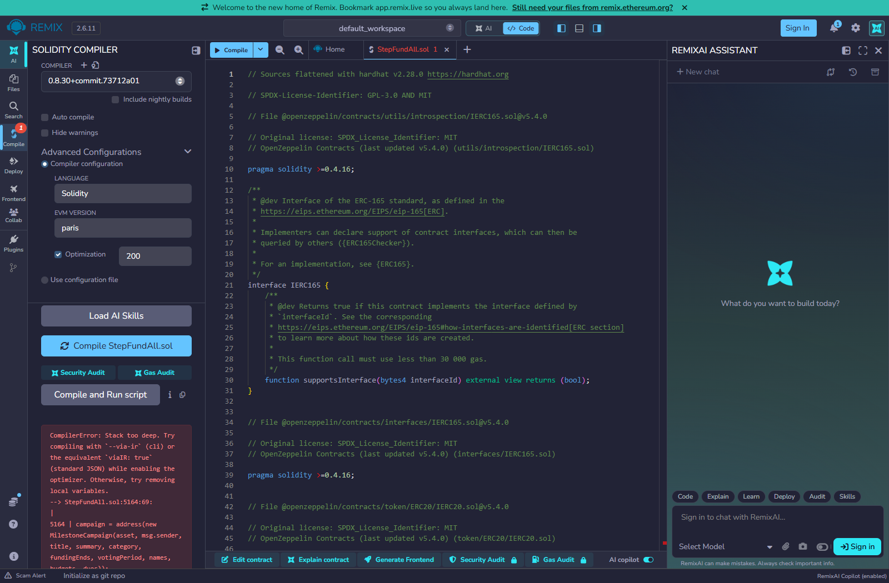
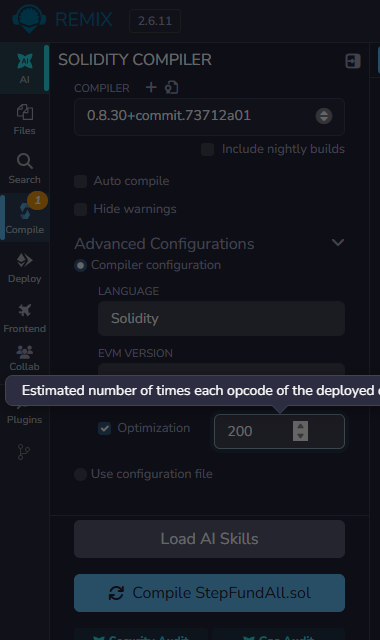
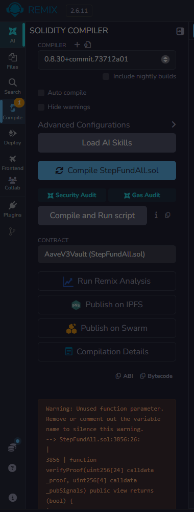
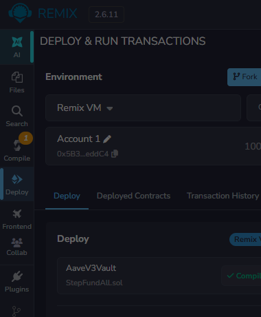

# StepFund 合约 Remix 兼容性改造与验证报告

- 项目：StepFund（里程碑托管式众筹，Hardhat + Vite/React 前端）
- 编译器：solc 0.8.30（`0.8.30+commit.73712a01`），EVM target `paris`，optimizer runs 200
- 验证环境：本机 Hardhat（chainId 31337）+ 在线 Remix IDE 2.6.11（Remix VM）
- 结论一句话：**改造后，全部 7 个合约可以在 Remix 面板默认设置下编译通过并部署；工厂不再依赖 via-IR。**

---

## 0. 结论摘要

| 项 | 改造前 | 改造后 |
|---|---|---|
| Remix 能否编译 | ❌ `StepFundFactory` 报 `Stack too deep` | ✅ 7 个合约全部编译通过（仅 1 条原有 warning） |
| 是否依赖 via-IR | 是（`hardhat.config` 里 `viaIR: true`） | 否（`viaIR: false`，Remix / Hardhat 都能编） |
| 工厂 runtime 体积 | 23,645 B（96.2%，余量 931 B） | 3,228 B（13.1%，余量 21,348 B） |
| 合约测试 | 57 passing | 57 passing |
| 领域测试 / 类型检查 | 39 passing / 干净 | 39 passing / 干净 |
| 本地链部署 | 通过 | 通过（factory `0xe7f1…0512`，3 个示例项目） |
| 前端 | 正常 | 正常（HTTP 200，控制台 0 error） |

> 另外：`npm run export:contracts` + `scripts/check-contract-bundle.cjs` 已重新同步并校验通过（6 个合约的 ABI / bytecode / 验证输入均与当前源码一致）。

---

## 1. 问题复现与根因

### 1.1 现象

原始代码把 8 个创建参数（其中 `title`、`summary`、`names[]`、`budgets[]`、`dues[]` 五个是动态类型）直接铺在 `createCampaign` / `createAdvancedCampaign` 上，并在函数体里内联 `new MilestoneCampaign(...)`。

在 Remix 2.6.11 上（0.8.30 + optimizer 200 + paris）编译：

```
CompilerError: Stack too deep.
  --> contracts/StepFundFactory.sol: createAdvancedCampaign
      campaign = address(new MilestoneCampaign(asset, msg.sender, title, summary, ...))
```

其余 6 个合约（`TestUSD`、`MilestoneCampaign`、`AcceptanceVerifier`、`ResearchVault`、`AaveV3Vault`）都能编过。也就是说：**写错的地方不在业务逻辑，而在函数签名的形状。**

### 1.2 根因一：legacy codegen 的 16 槽栈预算被入参吃光

不开 via-IR 时，Solidity 使用 legacy 代码生成器，函数内同时可达的栈槽上限是 16 个。而 legacy codegen 下**动态 calldata 参数各占 2 个槽**（offset + length）：

```
title(2) + summary(2) + category(1) + fundingEnds(1) + votingPeriod(1)
+ names[](2) + budgets[](2) + dues[](2) = 13 槽
```

再加返回变量 `campaign` 就 14~15 槽，函数体里几乎没有任何余量去做一次 10 参数的 `new`（还要额外拷贝 5 个动态参数）。这不是"挪几行代码"能解决的：把 `new` 抽成私有函数、把参数打包成 calldata 结构体、换 optimizer 设置都试过，报错只是换了个位置。

### 1.3 根因二：EIP-170 体积上限只差 931 字节

`StepFundFactory` 的 runtime 里嵌着被部署合约 `MilestoneCampaign` 的 init code（约 21 KB），因此：

| 编译方式 | Factory runtime | 是否可部署 |
|---|---|---|
| via-IR | 23,645 B | 可以，但只余 931 B（3.8%） |
| legacy（仅结构体改造后） | 25,909 B | **超出 24,576 B，部署会被链拒绝** |

即使解决栈问题，只要工厂还自己持有 campaign 的 creation code，legacy codegen 下就必然超限。**这两件事必须一起改。**

---

## 2. 改造方案

### 2.1 入参结构体化（解决栈溢出）

在 `MilestoneCampaign` 中定义创建参数结构体，工厂的两个入口各只收一个（或两个）参数：

```solidity
struct CreateRequest {
    string title; string summary; uint8 category;
    uint256 fundingEnds; uint256 votingPeriod;
    string[] names; uint256[] budgets; uint256[] dues;
}

function createCampaign(CreateRequest calldata request) external nonReentrant returns (address);
function createAdvancedCampaign(CreateRequest calldata request, AdvancedConfig calldata config)
    external nonReentrant returns (address);
```

栈基线从 13 槽降到 2 槽（calldata tuple 的指针 + length），函数体里才有空间完成部署。`MilestoneCampaign` 构造器改为 `constructor(CreateRequest memory r, address token_, address creator_, address factory_)`。

### 2.2 部署逻辑拆到 `CampaignDeployer`（解决体积）

新增 `contracts/CampaignDeployer.sol`：只做一件事——持有 campaign 的 creation code 并执行 `CREATE`。工厂在构造函数里部署它，并把自己记在 `factory` immutable 上，`deploy()` 只接受工厂调用。

```solidity
// StepFundFactory
campaign = deployer.deploy(msg.data[4:], asset, msg.sender);  // 直接转发编码好的 tuple，不重复编码
```

`msg.data[4:]` 是"去掉 4 字节 selector"后的完整入参编码，正好就是 `CreateRequest` 的 ABI 编码，所以热路径上没有任何二次编码开销。campaign 的 `factory` 由构造参数显式传入（因为它的部署者变成了 deployer），`initializeBond()` 的 `msg.sender == factory` 语义保持不变。

### 2.3 改造前后体积（optimizer 200，paris，无 via-IR）

| 合约 | runtime | 占 24,576 上限 | 结论 |
|---|---|---|---|
| `StepFundFactory` | 3,228 B | 13.1% | 余量 21,348 B |
| `CampaignDeployer` | 23,696 B | 96.4% | 余量 880 B |
| `MilestoneCampaign` | 18,454 B | 75.1% | 正常 |
| `AaveV3Vault` | 6,683 B | 27.2% | 正常 |
| `AcceptanceVerifier` | 6,365 B | 25.9% | 正常 |
| `ResearchVault` | 4,548 B | 18.5% | 正常 |
| `TestUSD` | 2,087 B | 8.5% | 正常 |

工厂从"贴着上限"变成"完全没有体积压力"，这也是之前报告里提示的 931 字节风险的正解。

---

## 3. 验证结果

### 3.1 编译矩阵（solc 0.8.30，离线复算）

| 配置 | 结果 |
|---|---|
| optimizer 200 + paris + **无 via-IR** | 0 error，2 warning（含原有的 `verifyProof` 未用参数） |
| optimizer 200 + paris + via-IR | 0 error，1 warning（保持双向兼容） |
| optimizer **关闭** + 无 via-IR | 0 error，但 `MilestoneCampaign` 31,746 B / `CampaignDeployer` 39,674 B **双超限** |

> 最后一行很重要：Remix 2.6.11 的面板里 **Optimization 复选框默认是空的**。不勾选，编译能过，但部署阶段会被 `code size exceeds 24576` 拦下。**在 Remix 必须手动勾上 Optimization（runs 200）。**

### 3.2 自动测试

| 套件 | 命令 | 结果 |
|---|---|---|
| 合约测试 | `npx hardhat test` | **57 passing**（含 treasury、Aave mock、真实 PLONK 证明、重入/对抗/治理用例） |
| 领域测试 | `tsx --test test-domain/*.test.ts` | **39 passing** |
| 类型检查 | `tsc --noEmit` | 无输出（干净） |

### 3.3 本地链部署（真实交易）

```
token          0x5FbDB2315678afecb367f032d93F642f64180aa3
factory        0xe7f1725E7734CE288F8367e1Bb143E90bb3F0512
verifier       0xCafac3dD18aC6c6e92c921884f9E4176737C052c
researchVault  0x9fE46736679d2D9a65F0992F2272dE9f3c7fa6e0
protocolVersion 3   blockNumber 3
Created 3 real local-chain projects. The first has an open vote.
```

工厂构造函数在部署时顺带创建了 `AcceptanceVerifier` 与 `CampaignDeployer`，3 个示例项目均创建成功（含 bond 收取与 `initializeBond`）。

### 3.4 前端

`node scripts/run-framework.mjs dev` → `http://127.0.0.1:5173` 返回 200，页面文案完整渲染，控制台 0 error（`remix-verify/local-home-2.png`）。

### 3.5 Remix 在线实测

把 `remix-verify/StepFundAll.sol`（7 个合约 flatten 成单文件，已去 BOM、去重复 SPDX）拖进 remix.ethereum.org：

| 项 | 实测值 |
|---|---|
| 编译器 | `0.8.30+commit.73712a01` |
| Optimization | 手动勾选，runs = 200 |
| via-IR | **无此开关**（Remix 面板不提供），也不需要了 |
| 编译结果 | 通过：出现 `Run Remix Analysis / Publish on IPFS / Publish on Swarm / Compilation Details / ABI / Bytecode` 等编译后才有的入口 |
| 产物 | `StepFundFactory`、`CampaignDeployer`、`MilestoneCampaign`、`AcceptanceVerifier`、`AaveV3Vault`、`ResearchVault`、`TestUSD` 全部在列 |
| 错误 | 0；仅 `Warning: Unused function parameter`（`verifyProof` 的 `_pubSignals`，改造前就有） |
| Deploy & Run | 环境 `Remix VM`，合约行显示绿色 `Compiled` 徽标，Deploy 按钮可用 |

证据截图（均在 `remix-verify/`）：



*图 1　改造前，Remix 2.6.11（无 via-IR 开关）在 `createAdvancedCampaign` 处报 Stack too deep*



*图 2　改造后，同一份单文件在 Remix 里选 0.8.30、勾选 Optimization、runs=200*



*图 3　编译成功（出现 Publish on IPFS / Compilation Details 等入口），只剩 1 条未用参数的 warning*



*图 4　Deploy & Run 面板：Remix VM、合约显示绿色 Compiled、Deploy 可用*

---

## 4. 改动清单

| 文件 | 改动 |
|---|---|
| `contracts/MilestoneCampaign.sol` | 新增 `CreateRequest` 结构体；构造器改为 `(CreateRequest, token, creator, factory)` |
| `contracts/CampaignDeployer.sol` | **新增**：持有 creation code，仅接受工厂调用 |
| `contracts/StepFundFactory.sol` | 两个创建入口改为 tuple 入参；构造时部署 deployer；`_register` 回归 `(campaign, title)` 两参 |
| `hardhat.config.cjs` | `viaIR: true` → `false`（附注释说明原因） |
| `lib/stepfund/chain.ts` | `FACTORY_ABI` 两条签名改为 tuple；两处调用由展开参数改为传数组 |
| `test/StepFund.cjs`、`StepFund.adversarial.cjs`、`StepFund.governance.cjs`、`StepFund.token-safety.cjs` | 调用点改为单参数数组（共 9 处） |
| `scripts/deploy.cjs`、`evidence-sharing-smoke.cjs`、`governance-ipfs-smoke.cjs` | 同上（3 处） |
| `remix-verify/` | 单文件 `StepFundAll.sol` + 编译/尺寸校验脚本 + 在线 Remix 自动化脚本 + 截图 |

**对外 ABI 变化**（需要知情）：

```
createCampaign(string,string,uint8,uint256,uint256,string[],uint256[],uint256[])
  → createCampaign((string,string,uint8,uint256,uint256,string[],uint256[],uint256[]))

createAdvancedCampaign(...,tuple(address,address,address,uint64[],uint64[]))
  → createAdvancedCampaign(tuple(8 项), tuple(address,address,address,uint64[],uint64[]))
```

函数名不变，但 selector 变了；仓库内的前端、测试、脚本已全部同步，外部若有硬编码旧 ABI 的调用方需要一起改。

---

## 5. 在 Remix 里复现（照这个顺序点）

1. 打开 <https://remix.ethereum.org>，把 `remix-verify/StepFundAll.sol` 上传到 File Explorer。
2. 左侧 **Solidity Compiler** → 版本选 `0.8.30+commit.73712a01`。
3. 展开 **Advanced Configurations** → **勾上 Optimization**，runs 填 `200`（**默认没勾，务必勾**）。
4. 点 **Compile StepFundAll.sol**；出现 `Publish on IPFS` 等入口即成功。
5. 左侧 **Deploy & Run** → Environment 选 `Remix VM` → CONTRACT 里选：
   - 先部署 `TestUSD`（无参）→ 复制地址；
   - 再选 `StepFundFactory`，`asset_` 填刚拿到的 TestUSD 地址 → Deploy。
6. 工厂构造函数会自动创建 `AcceptanceVerifier` 与 `CampaignDeployer`，随后即可直接调 `createCampaign`（入参是一个含 8 个字段的 tuple）。

---

## 6. 复跑命令

```bash
# 编译（无 via-IR）+ 测试
npx hardhat compile --force
npx hardhat test

# 领域测试 + 类型检查
npx tsx --test "test-domain/*.test.ts"
npx tsc --noEmit

# 本地链 + 部署 + 前端
npx hardhat node                     # 另一个终端
npx hardhat run scripts/deploy.cjs --network localhost
npm run dev

# 离线校验尺寸（本报告所有体积数据的来源）
node remix-verify/compile-all.cjs                 # 无 via-IR, runs 200, paris
node remix-verify/compile-all.cjs --via-ir
node remix-verify/compile-all.cjs --no-opt        # 复现"不勾优化器会超限"
node remix-verify/compile-all.cjs --runs=1 --evm=shanghai

# 同步前端用的 ABIS/bytecode/验证输入，并校验与当前源码一致
npm run export:contracts
node scripts/check-contract-bundle.cjs
```

---

## 7. 遗留风险与建议

1. **`CampaignDeployer` 余量只有 880 字节（96.4%）**。以后只要给 `MilestoneCampaign` 加功能（增添函数、事件、状态变量都会同时进入它的 creation code），就可能先把 deployer 撑爆。建议：给 `MilestoneCampaign` 的 runtime 加一条 CI 断言（> 23,000 B 时报警），或后续把 campaign 的纯校验逻辑抽成外部 library。
2. **工厂 initcode 33,802 B**（EIP-3860 上限 49,152 B），仍有余量，但离"能再加一个大合约"不远。
3. **Remix 默认 EVM version 是 `default`（0.8.30 → cancun），项目 Hardhat 配置是 `paris`**。两者都能编，字节码地址/体积会略有差异；如果要和链上已验证的字节码逐字节比对，请把 Remix 的 EVM VERSION 也选成 `paris`。
4. **Optimization 必须手动勾**（见 3.1 最后一行），这是最容易踩的坑：编译不报错，部署才失败。
5. via-IR 仍然可用（0 error），所以现在两条编译路径都通；`hardhat.config.cjs` 选 `false` 只是为了让"Remix 能不能编"这件事永远在 CI 里被覆盖。
